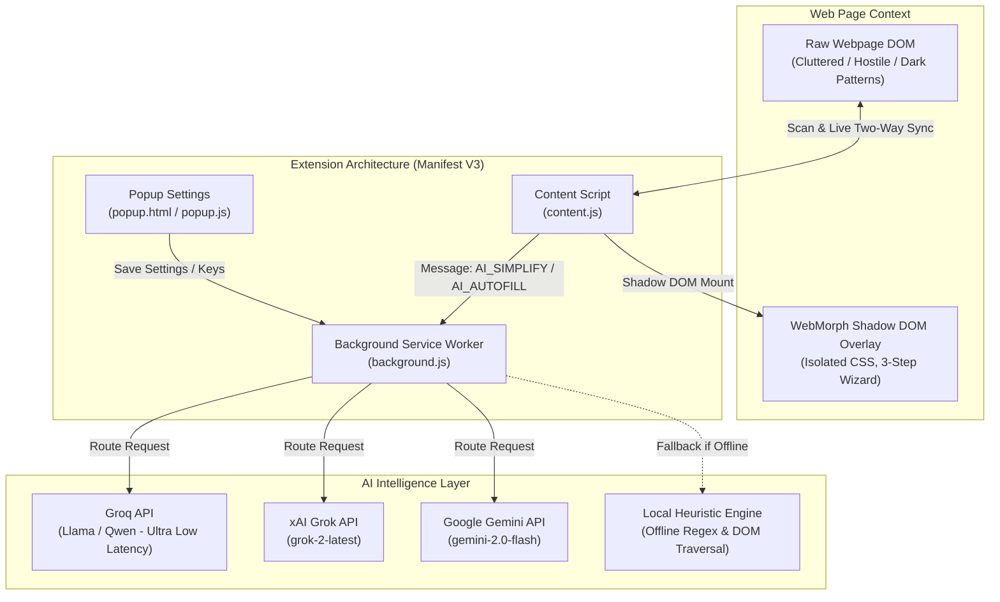

# 🌀 WebMorph — Universal Web Agent & Anti-Dark-Pattern Engine

> **Morph any cluttered, hostile, or complex webpage into a clean, accessible, dark-pattern-free guided flow with live DOM synchronization.**

[](manifest.json)
[](#-multi-model-ai-architecture)
[](#-accessibility--inclusivity-first)
[](LICENSE)

---

## 💡 Inspiration & Problem Statement

Modern websites are increasingly overwhelmed by:
1. **Aggressive Dark Patterns**: Hidden opt-in checkboxes, misleading convenience fees, fake scarcity timers (*"Only 2 rooms left!"*), and convoluted cancellation flows designed to exploit cognitive fatigue.
2. **Cognitive & Accessibility Barriers**: Overcomplicated multi-column forms with unlabelled fields, low-contrast typography, and cognitive overload that exclude elderly users, visually impaired individuals, and non-native speakers.
3. **Reckless Agent Automation**: Traditional AI browser agents attempt to click and submit forms autonomously in headless environments, leading to costly mistakes, privacy hazards, and broken checkout sessions.

**WebMorph solves this by turning any webpage inside-out.** Rather than delegating your browser to an unmonitored bot, WebMorph injects a **clean, accessible, localized 3-step wizard directly over the page** that syncs bidirectionally with the underlying DOM in real time—giving humans complete visibility and sovereign control.

---

## ✨ Key Features

### 🛡️ 1. Real-Time Dark Pattern Shield & Trap Neutralizer
- **Pre-Checked Opt-Ins**: Instantly detects and flags sneakily pre-checked checkboxes (insurance add-ons, spam newsletters, recurring subscriptions).
- **Urgency & Scarcity Scrapers**: Identifies predatory countdown timers, artificial scarcity phrases, and hidden fine print.
- **One-Click Trap Neutralization**: Unchecks deceptive inputs and visibly crosses out manipulative text with `[🛡️ BLOCKED BY WEBMORPH]` indicators.

### 🔄 2. Zero-Jitter Live DOM Synchronization
- As you type or dictate into WebMorph's simplified inputs, values are injected into the underlying webpage's native elements using synthetic prototype setters and native event dispatches (`input`, `change`).
- Real DOM fields pulse with a smooth **green outline** and smoothly scroll into view, ensuring 100% compatibility with React, Angular, Vue, and vanilla DOM validation.

### 🧠 3. Multi-Model AI Reasoning + Offline Heuristic Engine
- **Flexible Provider Support**: Plug in your API key for **Groq** (ultra-low latency with Llama/GPT-OSS/Qwen), **xAI Grok** (`grok-2-latest`), or **Google Gemini** (`gemini-2.0-flash`).
- **Autonomous Key Detection**: Detects your provider automatically based on key prefixes (`gsk_`, `xai-`, `AIzaSy`).
- **Robust Local Fallback**: If no API key or network is available, WebMorph’s local regex and semantic heuristic engine performs smart auto-fill and dark-pattern neutralization entirely on-device!

### 🚦 4. Human-in-the-Loop Safety Gate
- WebMorph adheres to the principle of **Auditable Autonomy**.
- It organizes long forms into three logical steps:
  1. **Essentials**: High-priority inputs (name, contact, primary choices).
  2. **More Info**: Contextual and secondary fields.
  3. **Safety Gate**: A comprehensive audit view displaying every field to be submitted and traps neutralized. It **never triggers payments or submissions without explicit user authorization**.

### 🌐 5. Multilingual & Accessibility First
- **Multilingual Simplification**: Automatically translates and simplifies technical jargon into **English, Hindi (हिन्दी), Kannada (ಕನ್ನಡ), Gujarati (ગુજરાતી)**, and more.
- **Voice-to-Action (Speech Recognition)**: Tap the 🎤 mic and speak natural goals (*e.g., "Book for John Doe, john@example.com, arrival tomorrow"*).
- **Audio Readout (Speech Synthesis)**: Reads out the page summary and detected traps aloud for visually impaired users.
- **WCAG AAA Compliance**: High-contrast mode (pure black/yellow/green), dynamic font scaling (`A+`), split-view vs. full takeover drawer, and full keyboard navigation (`Alt + M` toggle, `Esc` dismiss).

---

## 🏗️ System Architecture



---

## 📂 Project Structure

```
Webmorph/
├── manifest.json       # Chrome Extension Manifest V3 configuration & permissions
├── background.js       # Service worker: Multi-model AI routing, key detection & prompts
├── content.js          # Core engine: DOM scanner, Shadow DOM UI, dark pattern shield & sync
├── popup.html          # Extension popup UI (settings, language picker, API key input)
├── popup.js            # Popup controller & active tab message dispatcher
├── .gitignore          # Repository hygiene & secret exclusion
└── README.md           # Comprehensive documentation & hackathon showcase
```

---

## 🚀 Quickstart & Installation

### Prerequisites
- Google Chrome, Brave, Arc, Edge, or any Chromium-based browser.
- *(Optional)* An API key from [Groq Cloud](https://console.groq.com), [xAI](https://x.ai), or [Google AI Studio](https://aistudio.google.com).

### Step-by-Step Setup

1. **Clone or Download the Repository**:
   ```bash
   git clone https://github.com/<your-username>/webmorph.git
   cd webmorph
   ```

2. **Load the Extension in Chrome**:
   - Open your browser and navigate to `chrome://extensions/`.
   - Enable **Developer mode** (toggle in the top-right corner).
   - Click **Load unpacked** in the top-left corner.
   - Select the `Webmorph` directory.

3. **Configure Settings (Optional)**:
   - Click the WebMorph icon in the Chrome toolbar.
   - Paste your **Groq**, **Grok**, or **Gemini** API key (or use the built-in default/offline engine).
   - Select your preferred simplified language (*e.g., Hindi, Kannada, Gujarati, or English*).
   - Click **Save Settings**.

---

## 🎮 How to Use

1. **Browse to Any Complex Page**:
   - Open any booking portal, subscription sign-up, government portal, or eCommerce checkout.
2. **Launch WebMorph**:
   - Press <kbd>Alt</kbd> + <kbd>M</kbd> or click **Activate WebMorph** in the extension popup.
3. **Inspect & Neutralize Traps**:
   - View detected pre-checked checkboxes and urgency traps in the **Dark Pattern Shield**.
   - Click **Neutralize Traps** to disarm them with a single click.
4. **Goal-Based Auto-Fill**:
   - In the **AI Goal Auto-Fill** box, type or speak your intent (*e.g., "My name is Priya Sharma, email priya@test.com, city Mumbai"*).
   - Watch the underlying page auto-populate with smooth visual feedback!
5. **Approve via Safety Gate**:
   - Progress through Step 1 and 2, then review the final verification summary in Step 3 before approving submission.

---

## 🏆 Hackathon Value & Impact

| Category | Why WebMorph Stands Out |
|---|---|
| **Social Good & Inclusion** | Bridges the digital divide for elderly and non-English-speaking users by demystifying predatory web UIs. |
| **Consumer Protection** | Defends internet users against regulatory dark patterns (FTC & EU Digital Services Act compliance awareness). |
| **Novel Agent Paradigm** | Replaces opaque "black-box" headless browser agents with transparent, collaborative **In-Browser DOM Morphing**. |
| **Engineering Rigor** | Zero external dependencies; 100% native Web APIs, isolated Shadow DOM styling, and resilient multi-model fallbacks. |

---

## 🛣️ Roadmap

- [ ] **Community Dark Pattern Blacklist**: Crowdsourced reporting and pattern sharing via decentralized registry.
- [ ] **Custom Style Profiles**: High-legibility dyslexia-friendly fonts (OpenDyslexic) and custom color themes.
- [ ] **Multi-Step Form Crawler**: Automatic pre-fetching and progression across paginated multi-page application flows.
- [ ] **Firefox & Safari WebExtensions Port**: Cross-browser Manifest V3 compatibility.

---

## 📄 License

This project is licensed under the **MIT License** - see the [LICENSE](LICENSE) file for details.
